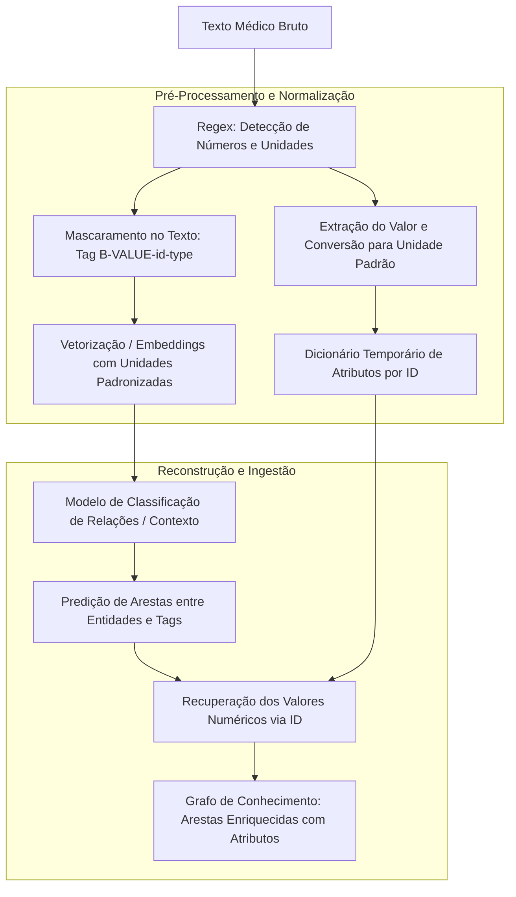

Aula 28/10
Rafael Hoyos (175100), Thiago Nascimento (252937)

Pontos:

- Quantidades devem ir para arestas do grafo, assim como modelado no projeot em grupo.
- Regex que identifica números e undades de medida + código que extrai o valor numérico e converte para uma unidade padronizada (para cada tipo de grandeza)
- Com auxílio do regex, unidades equivalentes são associados aos mesmos embeddings
- Essas quantidades encontradas serão associadas às suas devidas posições e contextos no texto
- os valores podem ser substituídos por uma tag (ex "B-VALUE-{id}" ou "B-VALUE-{id}-{type}"), tanto num treino, como num teste, se isso for melhorar o desempenho do modelo que interpreta os embeddings. Neste caso o "id" já ajuda na recuperação do valor numérico depois.
- o modelo deve ser treinado para classificar contextos em arestas que podem possuir quantidades associadas, que podem ser recuperadas a partir dos valores identificados nas primeiras etapas.

## Perguntas:

1. Como você vai encontrar os trechos candidatos a extração?
As quantidades serão com os Regex.
Para os termos específicos que devem virar nós entramos em uma disccussão um pouco mais complicada sobre o funcionamento do modelo utilizado. Primeiramente podemos encontrar termos candidatos a partir de uma análise de unigramas, digramas etc jogados (no formato de embedding) em outro modelo que apenas diz se aquele termo pode ser um nó (como doença, exame, sintoma), como se fosse um "dicionário inteligente" que utilza embeddings (o que agrega informações semânticas e gramaticais indietamente).Tendo o embedding do termo candidato, concatenamos ao embedding do contexto dele (média ou soma das compontentes da frase, janela de plavras próximas etc) e jogamos em um modelo treinado para dizer se esse termo realmente é um nó e qual tipo de aresta ele tem.

2. Como você vai relacionar o trecho encontrado a um achado ou medicação?
Já temos um nó e uma aresta, basta encontrar outro termo candidato que condiz com o tipo de aresta/nó já conhecidos e mandar o mesmo modelo ou outro um pouco adaptado para dizer se há ligação, cruzando informações dos contextos de cada termo.
Sobre as quantidades, conhecemos os tipos de arestas que devem receber um atributo de quantidade e a grandez dessa quantidade também.. associar essas informações com as quantidades já identificadas anteriormente não deve ser difícil (a partir de posição no texto, id etc), mas ainda podemos pensar em adaptar o modelo / criar um novo para associar as quantidades de maneira mais inteligente.

3. Como você vai recortar partes do exame para estruturá-lo?
Como já foi indicado, o texto seria dividido em "contextos" a partir das frases e janelas de palavras, que serão enviadas aos modelos/algoritmos de classificação.

---

## Ideias do Gemini sobre o fluxo acima

#### Diretrizes de Modelagem e Pipeline

* **Modelagem de Quantidades nas Arestas:**
  * As quantidades (dosagens, frequências, durações, resultados de exames) não formam nós soltos no grafo, mas sim **atributos/propriedades estruturados nas arestas** que conectam as entidades clínicas (ex: `(Medicamento) -[DOSAGE {valor: 500, unidade: "mg", valor_std: 0.5, unidade_std: "g"}]-> (Paciente)`).
  * Reduz a esparsidade de nós numéricos e otimiza consultas analíticas.

* **Reconhecimento Heurístico via Regex e Padronização de Unidades:**
  * Uso de **Expressões Regulares (Regex)** para capturar numerais (inteiros, decimais, intervalos) e unidades de medida adjacentes no texto bruto.
  * Módulo de pós-processamento que identifica o tipo de grandeza (Massa, Volume, Frequência, Tempo, Concentração) e converte o valor numérico para uma **unidade de medida padronizada** (ex: converter `500 mg` e `0.5 g` para a mesma base).

* **Alinhamento Semântico e Embeddings de Unidades Equivalentes:**
  * As unidades extraídas são mapeadas para tokens normativos ou representações vetoriais unificadas, garantindo que variações de grafia (ex: *"mg"*, *"mgs"*, *"milligrams"*) compartilhem os mesmos embeddings contextuais no modelo.

* **Mascaramento de Texto com Tags Contextuais (`B-VALUE-{id}`):**
  * Substituição das quantidades no texto por *placeholders* padronizados: `B-VALUE-{id}` ou `B-VALUE-{id}-{type}` (ex: `B-VALUE-01-DOSE`, `B-VALUE-02-FREQ`).
  * **Vantagens:**
    * Evita a esparsidade gerada por valores numéricos arbitrários durante o processamento do modelo.
    * Preserva o contexto sintático/semântico e a posição original das entidades na sentença.
    * O campo `{id}` atua como chave de recuperação para os valores e unidades armazenados em uma tabela/dicionário temporário.

* **Classificação Contextual e Ingestão de Arestas:**
  * O modelo de aprendizado é treinado sobre o texto mascarado para classificar se o contexto entre uma entidade (ex: *Paracetamol*) e uma tag de valor (`B-VALUE-01`) estabelece uma relação/aresta válida.
  * Na etapa final, os atributos numéricos originais e normalizados são recuperados pelo `{id}` da tag e injetados na aresta do grafo.

#### Exemplo Prático de Execução

1. **Texto de Entrada:**  
   *"Paciente iniciou uso de Paracetamol 500mg a cada 8h por 5 dias."*

2. **Mapeamento Regex & Tabela Temporária de Atributos:**  
   * **ID 1:** `500mg` $\rightarrow$ Tipo: Dosagem | Valor: `500`, Unidade: `mg` | Normalizado: `0.5g`  
   * **ID 2:** `a cada 8h` $\rightarrow$ Tipo: Frequência | Valor: `8`, Unidade: `horas`  
   * **ID 3:** `por 5 dias` $\rightarrow$ Tipo: Duração | Valor: `5`, Unidade: `dias`  

3. **Texto Mascarado para Alimentação do Modelo:**  
   *"Paciente iniciou uso de Paracetamol B-VALUE-1-DOSE B-VALUE-2-FREQ B-VALUE-3-DUR."*

4. **Predição e Ingestão no Grafo:**  
   * Relação prevista: `(Paracetamol) -[HAS_DOSAGE]-> (Paciente)`  
   * Propriedades gravadas na aresta: `{dose: 500, unit: "mg", dose_std: 0.5, unit_std: "g", freq: "8h", duration: "5d"}`

---