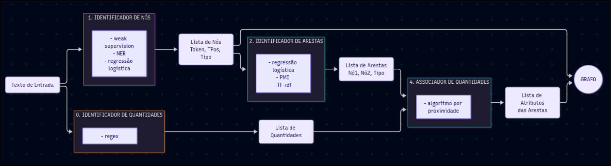
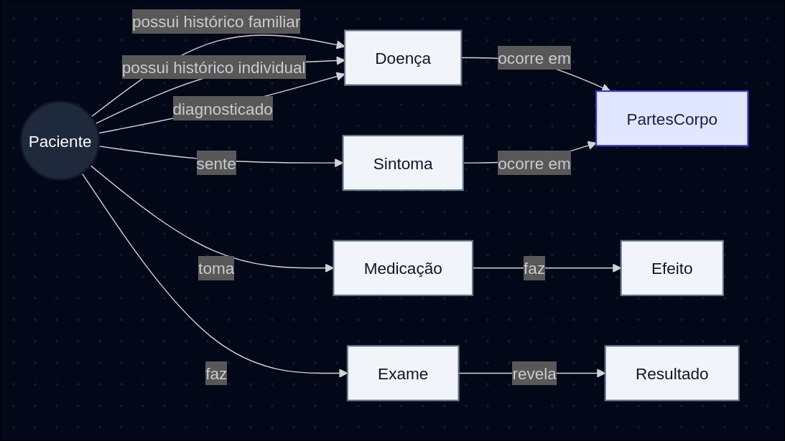

# project02 Diplotokens

<a target="_blank" href="https://cookiecutter-data-science.drivendata.org/">
    
</a>

Projeto 2 da equipe Diplotokens para a disciplina NLP da Unicamp (2026.2)

## Project Organization

```
├── LICENSE            <- Open-source license if one is chosen
├── Makefile           <- Makefile with convenience commands like `make data` or `make train`
├── README.md          <- The top-level README for developers using this project.
├── data
│   ├── external       <- Data from third party sources.
│   ├── interim        <- Intermediate data that has been transformed.
│   ├── processed      <- The final, canonical data sets for modeling.
│   └── raw            <- The original, immutable data dump.
│
├── docs               <- A default mkdocs project; see www.mkdocs.org for details
│
├── models             <- Trained and serialized models, model predictions, or model summaries
│
├── notebooks          <- Jupyter notebooks. Naming convention is a number (for ordering),
│                         the creator's initials, and a short `-` delimited description, e.g.
│                         `1.0-jqp-initial-data-exploration`.
│
├── pyproject.toml     <- Project configuration file with package metadata for 
│                         diplo_graph2 and configuration for tools like black
│
├── references         <- Data dictionaries, manuals, and all other explanatory materials.
│
├── reports            <- Generated analysis as HTML, PDF, LaTeX, etc.
│   └── figures        <- Generated graphics and figures to be used in reporting
│
├── requirements.txt   <- The requirements file for reproducing the analysis environment, e.g.
│                         generated with `pip freeze > requirements.txt`
│
├── setup.cfg          <- Configuration file for flake8
│
└── diplo_graph2   <- Source code for use in this project.
    │
    ├── __init__.py             <- Makes diplo_graph2 a Python module
    │
    ├── config.py               <- Store useful variables and configuration
    │
    ├── dataset.py              <- Scripts to download or generate data
    │
    ├── features.py             <- Code to create features for modeling
    │
    ├── modeling                
    │   ├── __init__.py 
    │   ├── predict.py          <- Code to run model inference with trained models          
    │   └── train.py            <- Code to train models
    │
    └── plots.py                <- Code to create visualizations
```

--------

## Slides

> Coloque aqui o link para o PDF da apresentação da parte 2.
Link do canva: https://canva.link/0oid1yea0xke50l  

## Demonstração Executável

> Coloque aqui um link para uma demonstração executável do seu código. Pode ser um Jupyter notebook (rodando no Binder ou no Colab) e/ou uma página Web que apresente visualmente seus resultados.

Você pode executar o pipiline completo do nosso modelo rodando o seguinte notebook: [Abrir o notebook completo](notebooks/pipeline_completo.ipynb)

## Metodologia
> Descreva aqui a metodologia que foi usada para a extração do grafo de conhecimento. Você pode apresentar um diagrama, com estágios e descrever cada um deles.

> Nesta seção podem aparecer destaques de código como indicado a seguir. Note que foi usada uma técnica de highlight de código, que envolve colocar o nome da linguagem na abertura de um trecho com `~~~`, tal como `~~~python`.
>
> Os destaques de código devem ser trechos pequenos de poucas linhas, que estejam diretamente ligados a alguma explicação. Não utilize trechos extensos de código. Se algum código funcionar online (tal como um Jupyter Notebook), aqui pode haver links. No caso do Jupyter, preferencialmente para o Binder abrindo diretamente o notebook em questão.

### Arquitetura do Projeto


0. **Pre-processamento**:

Nesta etapa, separamos os casos em conjuntos de treinamento e teste e aplicamos a tokenização para padronizar o texto nas abordagens testadas. O tokenizador divide o texto em palavras usando o NLTK, converte os tokens para minúsculas e remove pontuações; por padrão, mantém os números e reduz as palavras ao radical em inglês (stemming com Snowball).

Os arquivos responsáveis pela separação dos casos e pela tokenização estão em `models/pre_processamento`.

1. **Caixa preta 1 - Classificação de nós**:
- Abordagem 1: **NGNI**

Nesta abordagem, o NGNI (N-Grams Node Identifier) aprende padrões de linguagem a partir dos casos de treinamento rotulados e usa um modelo estatístico de n-gramas para localizar entidades no texto. Antes do treinamento, um léxico fixo de termos médicos identifica menções a doenças, sintomas, medicamentos, exames, anatomia, efeitos e resultados. Regras adicionais marcam menções ao paciente. Os termos encontrados são substituídos por tags, como `TAG-SYMPTOM`; em sobreposições, prioriza-se o trecho mais longo e, em caso de empate, a ordem de prioridade das categorias.

O modelo de n-gramas é treinado sobre os casos rotulados e também utiliza textos de referência do corpus Brown como contexto linguístico. São treinados modelos para percorrer as sequências nos sentidos direto e reverso. Na identificação, o NGNI combina as probabilidades dos contextos para decidir se uma palavra inicia uma entidade e qual é sua classe. Em seguida, avalia se palavras vizinhas devem fazer parte do mesmo trecho, respeitando limites definidos por pontuação, classe gramatical e tamanho máximo. Os hiperparâmetros são ajustados com validação separada por artigo, para que casos do mesmo artigo não sejam divididos entre treino e validação; o conjunto de teste fica reservado para a avaliação final. Na avaliação comparativa, a classe *Patient* não é contabilizada.

- Abordagem 2: **Rotulação fraca + Regressão Logistica Multinomial**

Nesta abordagem, a rotulação fraca usa um dicionário de termos MeSH (doenças, sintomas, exames, medicamentos, resultados e anatomia), normalizado da mesma forma que os casos. A busca prioriza correspondências mais longas e marca os tokens com rótulos BIO (`B-` para o início e `I-` para a continuação da entidade). Menções ao paciente são identificadas por regras; termos ambíguos guardam seus tipos candidatos, e casos sem um rótulo confiável são ignorados no treinamento.

Para cada token, extraímos características da própria palavra (forma, prefixos, sufixos e radical) e do contexto próximo, incluindo palavras vizinhas e tipos encontrados no dicionário. Durante o treinamento, parte das indicações do dicionário é ocultada para que o modelo também aprenda padrões linguísticos. Essas características são vetorizadas e usadas por uma regressão logística multinomial, com pesos balanceados entre classes. Na predição, o modelo classifica os tokens e usa o contexto para escolher entre os tipos candidatos de termos ambíguos.


2. **Caixa preta 2 - Classificação de arestas/relações**

Esta etapa identifica como as entidades extraídas se relacionam no texto. Primeiro, o sistema segmenta cada caso em sentenças e gera pares candidatos de entidades que aparecem na mesma sentença. A combinação de tipos restringe as relações possíveis: por exemplo, `Patient`–`Symptom` pode receber `PRESENTS_WITH`, e `Exam`–`Result` pode receber `REVEALS`. Quando uma sentença contém entidades clínicas, mas não menciona explicitamente o paciente, pode ser criado um nó `Patient` virtual como âncora. Para cada par, também são registrados a ordem de leitura, o texto entre as entidades, o contexto próximo, a distância em tokens e a presença de barreiras entre orações.

No conjunto de treinamento, esses pares recebem rótulos fracos por regras e pistas lexicais do texto, como termos relacionados a diagnóstico, histórico, negação e efeito. As relações consideradas incluem `DIAGNOSED_WITH`, `HISTORY`, `FAMILIAR_HISTORY`, `PRESENTS_WITH`, `TAKES`, `UNDERWENT_EXAM`, `LOCATED_IN`, `REVEALS` e `HAS_EFFECT`; pares sem evidência de uma relação válida recebem `NONE`. Esses rótulos são supervisão automática, não anotações clínicas revisadas manualmente, e podem conter ruído.

Para classificar os pares, o modelo combina quatro grupos de informações: tipos e combinação de tipos das entidades; características estruturais, como ordem, distância, mesma oração e palavras-cabeça; TF-IDF de unigramas e bigramas do trecho entre as entidades e do contexto local; e medidas de associação PMI entre os termos, suas palavras-cabeça e seus tipos. Essas características alimentam uma regressão logística multinomial com pesos balanceados entre classes. A validação cruzada separa os dados por artigo, evitando que casos do mesmo artigo apareçam simultaneamente em treino e validação. Depois da validação, o modelo é ajustado com os pares de treino e aplicado aos pares candidatos do teste; as predições diferentes de `NONE` são usadas como arestas do grafo, acompanhadas das probabilidades por classe e da confiança da predição.

3. **Identificação de quantidades**

A identificação de quantidades complementa as arestas do grafo com valores clínicos mencionados no texto. O sistema percorre cada sentença e usa expressões regulares para reconhecer números e formatos como dimensões (por exemplo, `6 cm x 9 cm`), medidas de peso e volume, pressão, frequência, tempo e unidades especiais. Números sem unidade só são aceitos em contextos restritos, como quando vêm após termos como `day`, `stage`, `grade`, `type` ou `level`; referências a figuras e tabelas também são filtradas para reduzir falsos positivos. Para cada ocorrência, são registrados o texto original, o valor, a unidade, a categoria da medida e sua posição no texto.

Depois, cada quantidade é associada a uma aresta positiva da mesma sentença. A seleção prioriza relações consideradas compatíveis com a categoria da medida — por exemplo, medidas de pressão podem ser associadas a `PRESENTS_WITH` ou `REVEALS` — e escolhe a aresta mais próxima dos nós relacionados, desde que esteja dentro do limite de distância configurado. Se não houver uma aresta compatível, o procedimento considera as demais arestas positivas da sentença. O valor, a unidade e o tipo da quantidade são adicionados como atributos da aresta; se houver mais de uma quantidade associada, as seguintes são armazenadas em campos adicionais. Na construção do grafo, esses atributos são preservados junto com a confiança da classificação da relação.

Como a extração é baseada em padrões de texto e a associação usa compatibilidade de tipo e proximidade, podem ocorrer omissões ou associações incorretas, sobretudo quando uma sentença contém várias entidades e medidas, ou quando uma unidade não está coberta pelas regras. A etapa também não interpreta por si só o significado clínico do valor, como sua normalidade ou a qual evento temporal se refere. A cobertura das expressões regulares, os limites de distância e as associações resultantes devem, portanto, ser avaliados em exemplos anotados e ampliados conforme os erros observados.

### Confronto com Trabalho Anterior

> Apresente dentro desta subseção um texto confrontando esta versão com a anterior. O confronto pode ser qualitativo ou baseado em comparações experimentais.

## Trabalhos Estudados

> Se foram feitas pesquisas de outros trabalhos, debata brevemente as referências.

## Modelo Lógico

> Modelo de grafo que a equipe criou. Para o modelo de grafos de propriedades, utilize este
> [modelo de base](https://docs.google.com/presentation/d/10RN7bDKUka_Ro2_41WyEE76Wxm4AioiJOrsh6BRY3Kk/edit?usp=sharing) para construir o seu.
> Coloque a imagem do PNG do seu modelo lógico como ilustrado abaixo (a imagem estará na pasta `image`):
>
> 

O modelo do grado permaneceu o que foi usado no projeto 1, pois durante discusões não se notou necessidade de alterar o modelo lógico para conseguir realizar a arquitetura que propusemos




## Análises que podem ser realizadas

> Apresente aqui uma análise  uma discussão de análises que podem ser realizadas com o seu grafo.
Com as caixas pretas estruturadas conseguimos realizar as seguinte comparações

1. Diferença entre soluções de classificação de nos

Nas métricas apresentadas, a regressão logística obteve F1 de 91,3% contra os rótulos fracos e de 89,5% quando consideramos apenas as classes comuns, enquanto o NGNI obteve 12,8% contra test_cases_labeled. Por classe, o LR apresentou seus melhores resultados em Anatomy (~95%) e Disease (~89%); no NGNI, o maior F1 foi em Anatomy (~23%), e Result não teve acertos. Uma possível explicação é que o LR combina características do token e do contexto com candidatos do dicionário, enquanto o NGNI pode ser mais sensível à identificação dos limites exatos das entidades e à classificação de cada tipo.

No entanto, essa diferença deve ser interpretada com cautela: os modelos foram avaliados contra referências distintas, e a avaliação do LR usa rótulos fracos produzidos a partir do dicionário que também orienta o modelo. Assim, os gráficos indicam maior concordância do LR com sua referência, mas uma comparação conclusiva exigiria avaliar os dois modelos contra o mesmo gabarito.


2. Comparação entre grafo projeto 1 e projeto 2

As duas imagens representam um caso clínico organizado em torno de um nó central do paciente. Nos dois grafos aparecem entidades de diferentes categorias — doenças, sintomas, exames e estruturas anatômicas — ligadas por relações como `DIAGNOSED_WITH`, `PRESENTS_WITH`, `UNDERWENT_EXAM` e `LOCATED_IN`. Isso mostra a continuidade do objetivo do projeto: transformar informações clínicas do texto em entidades e relações explícitas.

No grafo do projeto 1, o paciente é identificado principalmente pelo código do caso, e as entidades aparecem em grupos relativamente distintos ao seu redor. No grafo do projeto 2, o nó central explicita também o tipo `Patient`, e há exemplos mais específicos ou detalhados de entidades e exames, como `physical examination` e `esophagogastroduodenoscopy`. Também aparecem relações adicionais, como `PAPILLARY_HISTORY`, indicando uma tentativa de representar informações clínicas que não se limitam às relações mais frequentes. A disposição dos nós e das arestas torna mais visível a conexão entre o paciente, os diagnósticos, os sintomas, os exames e as localizações anatômicas.

Assim, a evolução observável está sobretudo na apresentação mais explícita do tipo das entidades e na maior variedade de conceitos e relações representados no exemplo do projeto 2. A imagem também permite notar pontos a revisar: alguns rótulos parecem pouco informativos ou ambíguos isoladamente — por exemplo, `her` —, e certos nomes longos ficam truncados. Isso sugere que a extração e a visualização podem se beneficiar de validação dos rótulos e de ajustes de apresentação. Como são exemplos visuais, e não uma comparação quantitativa de todos os grafos, eles ilustram diferenças, mas não bastam para concluir que o projeto 2 é globalmente mais completo ou preciso.


## Ferramentas

> Panorama das ferramentas utilizadas incluindo discussão sobre o uso das mesmas.

Diplograph: Ferramenta de visualização do grafo desenvolvida pelo modelo de linguagem Gemini.

Cookiecutter: Ferramenta de organização e estruturação inicial do projeto recomendada pelo professor, que após entendermos seu funcionamento, decidimos por seguir a recomendação e utilizar a ferramenta.


## Resultados

As métricas globais indicam que o classificador de arestas manteve desempenho parecido entre a validação cruzada no treino e o conjunto de teste. No teste, obteve precisão de **77,8%**, recall de **95,5%** e F1 de **85,7%**; no treino, os valores foram **79,7%**, **95,2%** e **86,7%**. A pequena queda de F1 no teste sugere que não houve uma degradação acentuada nesse conjunto. O recall alto mostra que o modelo recupera a maior parte das relações reais, enquanto a precisão menor indica que ainda propõe algumas relações incorretas.

O resumo considera as classes de aresta positivas, excluindo `NONE`. No teste foram avaliados **439 pares candidatos**, dos quais **176** correspondiam a arestas reais. Nesse cenário, a precisão de 77,8% equivale a cerca de uma em cada cinco relações positivas previstas não corresponder ao gabarito. A proporção entre pares positivos e negativos também importa: por isso, o F1 alto da classe `NONE` na tabela por tipo não deve ser confundido com o desempenho na identificação das relações que formam o grafo.

As métricas por tipo mostram resultados distintos entre relações. `UNDERWENT_EXAM` e `TAKES` tiveram F1 de **95,0%** no teste; `LOCATED_IN`, **82,4%**; `DIAGNOSED_WITH`, **81,5%**; `PRESENTS_WITH`, **80,9%**; e `REVEALS`, **80,0%**. Em contraste, `HISTORY` teve recall de apenas **16,7%** e F1 de **25,0%**, ou seja, a maior parte das relações desse tipo não foi recuperada. `FAMILIAR_HISTORY` apresentou F1 de **66,7%**, mas esse resultado deve ser visto com cautela devido ao baixo número de exemplos. `HAS_EFFECT` não aparece na tabela, então não é possível avaliar seu desempenho com os resultados apresentados. Assim, uma média global razoável esconde dificuldades importantes em relações menos frequentes ou mais ambíguas.

Entre os possíveis fatores estão o desequilíbrio na frequência das classes, a ambiguidade das pistas linguísticas e a dependência de rótulos fracos para construir os exemplos de treino. Relações como `HISTORY` e `FAMILIAR_HISTORY` podem exigir distinguir a história do próprio paciente da história familiar, algo que pistas lexicais isoladas nem sempre resolvem. Além disso, erros nas entidades extraídas anteriormente podem afetar os pares candidatos e, consequentemente, a classificação das arestas.

Como melhorias, recomendamos ampliar e revisar manualmente as anotações das relações raras, especialmente `HISTORY` e `FAMILIAR_HISTORY`; avaliar o modelo com métricas por classe e matriz de confusão, além das métricas globais; e investigar os falsos positivos para ajustar as pistas de rotulação, o esquema de relações e os limiares de decisão. Também é importante validar o pipeline completo — extração de nós e classificação de arestas — com um conjunto de referência anotado manualmente, pois as métricas atuais avaliam a classificação dos pares disponíveis e não necessariamente a qualidade final de todos os grafos produzidos.


## Como Modelos de Linguagem foram Usados

> Descreva aqui em que tarefas os modelos de linguagem foram usados.

## Referências Bibliográficas

> Lista de artigos, links e referências bibliográficas.
>
> Fiquem à vontade para escolher o padrão de referenciamento preferido pelo grupo.

Jurafsky, D. & Martin, J. H. (2026). Speech and Language Processing: An Introduction to Natural Language Processing, Computational Linguistics, and Speech Recognition with Language Models (3rd ed.).

Manning, C. D., Raghavan, P., & Schütze, H. (2009). Introduction to Information Retrieval. Cambridge University Press.

Manning, C. D., & Schütze, H. (1999). Foundations of Statistical Natural Language Processing. MIT Press.